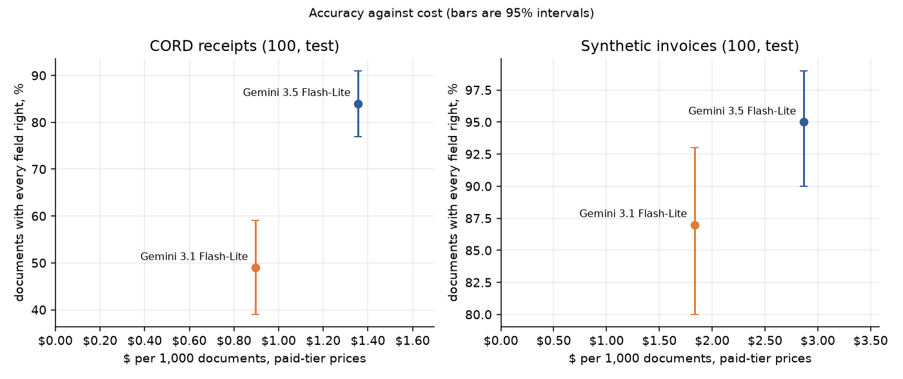
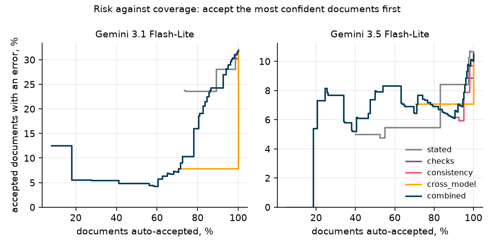
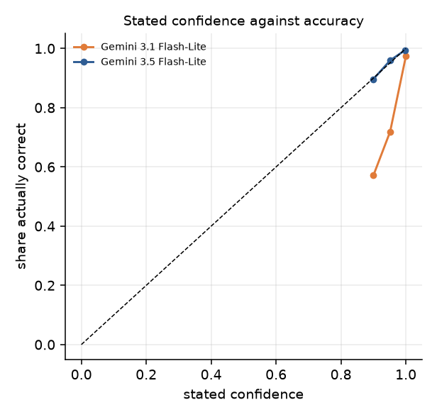
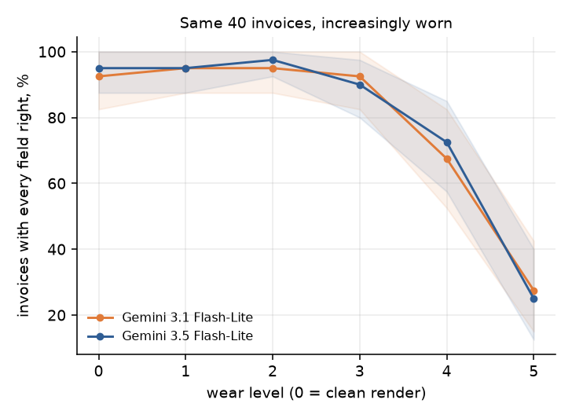
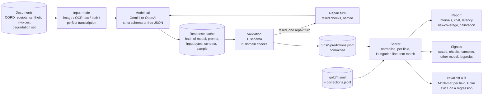

# extraction-evals

Schema-constrained extraction from receipts and invoices, with an eval harness that scores every field separately, tests which confidence signals actually predict errors, and catches a regression that the average accuracy hides.

Two models, 200 test documents (100 real receipts from CORD, 100 generated invoices), every prediction committed in [`runs/`](runs), every table and chart rebuilt from those files by one script.

## Results

Documents with every field right, test split, gold after the audit described below:

| | CORD receipts | Synthetic invoices | $ per 1,000 docs (receipts / invoices) |
|---|---|---|---|
| Gemini 3.1 Flash-Lite | 49% (39-59) | 87% (80-93) | $0.90 / $1.83 |
| Gemini 3.5 Flash-Lite | 84% (77-91) | 95% (90-99) | $1.36 / $2.87 |

Brackets are 95% bootstrap intervals, resampled by document. Costs are at paid-tier prices as of 2026-10-29; the runs themselves used the free tier. Per-field tables for everything below are in [`results/tables.md`](results/tables.md).



Per field, most of the gap on receipts is one field: 3.1 gets the subtotal right on 66% of receipts, 3.5 on 98%. On the 4 receipts that print no total, 3.1 filled one in on all 4 and 3.5 on 3.

### 1. The per-field diff caught a regression the mean barely shows

`prompt v2` is a shorter rewrite of the invoice prompt. It was meant to demo one planted regression: dropping the line about payment terms ("Net 30") should break `due_date`. That one didn't land. On the 45 invoices that give only payment terms, 3.5 got 44 right with both prompts and 3.1 went from 42 to 40, which the diff correctly calls noise.

What the diff flagged instead was `vendor_name`:

| Gemini 3.5 Flash-Lite | v1 | v2 | |
|---|---|---|---|
| vendor_name | 99% | 73% | p = 4.5e-07 after Holm, REGRESSION |
| mean of all fields | 98.9% | 97.3% | |

v2 lost the clause saying the legal name "may appear only in the footer". 31 test invoices have a short brand in the header (MERIDIAN) and the full name (Meridian Textiles Co.) only in the footer. With v1, 3.5 got 30 of those 31 right; with v2, 4. On the other 69 invoices nothing changed. 3.1 shows the same thing (25 of 31 down to 4). The mean drops 1.6 points, which on its own looks like nothing you'd stop a release for. `xeval diff` exits 1 on it.

### 2. 10 of 100 CORD test receipts had a label error

Fields where both models agreed with each other and disagreed with the gold went into a manual review against the image (`scripts/audit.py`). Of 26 candidates, 10 were label errors, all on CORD: a printed subtotal, total, discount or change the label missed, a misread item name, size modifiers labelled as items, and a card charge labelled as cash. One more turned up on the same receipt while checking. The other 16 were model errors: zero-priced toppings listed as items, a coupon counted as cash, a product code kept in the name, a total the receipt doesn't print, and three invoices, where the gold is exact by construction.

Each correction is in [`gold/corrections.jsonl`](gold/corrections.jsonl) with the reason. Every result is reported on both versions of the gold:

| ALL FIELDS on CORD | uncorrected gold | corrected gold |
|---|---|---|
| Gemini 3.1 Flash-Lite | 45% | 49% |
| Gemini 3.5 Flash-Lite | 77% | 84% |

The better model gains more from the correction, which I think is expected: more of its "errors" were the label's.

### 3. Which confidence signals predict an error

Each field gets several signals, and the question is whether ranking by a signal lets you auto-accept some documents while sending the rest to a person:

| Signal | Gemini 3.1 Flash-Lite AUROC | Gemini 3.5 Flash-Lite AUROC |
|---|---|---|
| stated (the model's own per-field confidence) | 0.67 | 0.79 |
| checks (arithmetic and format checks on the output) | 0.41 | 0.41 |
| consistency (agreement across 5 samples) | | 0.76 |
| cross_model (does the other model give the same value) | 0.88 | 0.65 |
| combined (logistic regression, cross-fitted in 5 folds over documents) | 0.93 | 0.76 |



- **Stated confidence depends on the model.** 3.5 is well calibrated (ECE 0.004). 3.1 says 0.9 on fields it gets right 57% of the time.
- **Checks score below chance, and that's real.** A failed check is a strong signal: 47% of the fields it flags on 3.1 are wrong. But it fires on about 1% of fields, and the fields that checks cover (subtotal, total) are the ones that go wrong most, so most errors pass every check. Checks are worth running for the repair turn; as a ranking signal they don't help.
- **A second model is the best signal for the weaker model.** For 3.1, disagreement with 3.5 finds most of its errors. For 3.5 the other model is weaker, so disagreement is mostly 3.1 being wrong.
- **With few errors there is little to learn.** 3.5 makes 27 field errors in about 2,000 fields, and at document level the combined model does worse than stated confidence alone (7% of documents auto-accepted at a 5% error rate, against 52%). For 3.1, the combined signal auto-accepts 58% of documents at a 5% document error rate.



### 4. Smaller things worth knowing

- **The repair turn hurts the smaller model.** When a check fails, the model gets one more turn with the failed checks named. On 3.1 that fixed 1 field and broke 7 that were right. On 3.5 it fixed 1 and broke 1.
- **On receipts the image beats a perfect transcription.** Given the exact text of a CORD receipt instead of the photo, 3.1 drops from 49% to 43%. On invoices the transcription is best (95% against 87%). My guess is receipt layout (indentation of modifiers, column position) carries meaning the plain text loses. OCR text alone collapses: 8% on receipts. Image plus OCR is about the same as the image alone (53% against 49%).
- **Strict schema against free JSON is mixed.** Free JSON scored higher for 3.1 and lower for 3.5; every interval overlaps. In free mode, 3.5 once echoed the JSON schema itself back instead of filling it in, twice in a row.
- **Wear only matters at the end.** The same 40 invoices at six levels of rotation, blur, noise and compression: flat through level 3, then about 70% at level 4 and about 25% at level 5.



## Setup

- **Models.** Gemini 3.1 Flash-Lite and 3.5 Flash-Lite, default settings, on the free tier (500 requests a day per model). The Flash models are left out because the free tier allows them 20 requests a day. Gemini returns no log-probabilities here, so the logprob signal is unused.
- **OpenAI backend.** `xeval/providers.py` also runs OpenAI models. Two gaps in the field specs were found by auditing dev-split errors from GPT runs (detail lines under an invoice item are not part of its description; an item named like a transport charge could fairly be read as shipping). Fixing them took invoice accuracy on dev from 61% to 84% on gpt-6-luna and from 75% to 94% on gpt-6.1-sol. Those dev runs are kept in `runs/dev-*`.
- **CORD.** 100 dev and 100 test receipts from Indonesian shops and restaurants. Field mapping in [`xeval/data/cord.py`](xeval/data/cord.py).
- **Invoices.** Generated from seeds and rendered with Pillow, so the gold is exact. A first version with clean layouts was solved by the smallest model, so each invoice now carries traps real invoices have: locale number formats, day-first dates, a brand header with the legal name in the footer, payment terms instead of a due date, split taxes, deposits, multi-page tables, scan wear. See [`xeval/data/invoices.py`](xeval/data/invoices.py).
- **Scoring.** Exact match after normalisation per field; ANLS for item descriptions; line items matched with the Hungarian algorithm. A document counts only if every field is right.
- **Statistics.** Intervals are a document-level bootstrap. Prompt and model comparisons are paired: McNemar's exact test per field, Holm correction across fields, and the smallest difference the sample could detect, printed next to each p-value.

## Architecture



| File | What it does |
|---|---|
| [`xeval/schema.py`](xeval/schema.py) | One field spec per document type, used as the model's JSON schema, the validator's field list and the scorer's field list. |
| [`xeval/prompts.py`](xeval/prompts.py) | The prompts, v1 and the shorter v2, and the repair turn. |
| [`xeval/normalize.py`](xeval/normalize.py) | Parses printed amounts in the gold (`16,500`, `Rp 9.736`, `@ 12.000`) and canonicalises predictions: dates, money, text, IDs. ANLS. |
| [`xeval/checks.py`](xeval/checks.py) | Domain checks. Each one names the fields it touches. |
| [`xeval/score.py`](xeval/score.py) | Per-field scoring; line items matched with the Hungarian algorithm. |
| [`xeval/stats.py`](xeval/stats.py) | Bootstrap intervals, McNemar's exact test, Holm correction, detectable-difference calculation, AUROC, ECE, risk-coverage. |
| [`xeval/providers.py`](xeval/providers.py) | OpenAI and Google behind one call. Prices with their date. |
| [`xeval/run.py`](xeval/run.py) | The runner: cache, repair loop, samples, spend cap, resume. |
| [`xeval/confidence.py`](xeval/confidence.py) | Confidence signals per field, the combined logistic model. |
| [`xeval/diff.py`](xeval/diff.py) | The regression diff. |
| [`xeval/data/cord.py`](xeval/data/cord.py), [`xeval/data/invoices.py`](xeval/data/invoices.py) | Dataset conversion and the invoice generator. |
| [`scripts/audit.py`](scripts/audit.py) | Lists gold audit candidates: fields where every run agrees against the label. |
| [`scripts/results.py`](scripts/results.py) | Every table and chart in this README, from the committed predictions. |

## Running it

```bash
pip install -e .
python -m xeval data                      # download CORD, render the invoices, write gold/
python -m xeval report                    # rebuild results/ from runs/, no API key needed
python -m xeval diff lite-3.5 lite-3.5-v2 # the regression above; exits 1
```

To run models, copy `.env.example` to `.env`, add a Gemini or OpenAI key and run `python -m xeval run configs/gemini.json`. Responses are cached, so a run that stops on a quota resumes where it left off. The OCR input modes need Tesseract installed.

## Limitations

- 100 documents per set. The intervals are wide, and the paired tests are there because of it.
- The invoices are synthetic. They catch specific failure modes on purpose; they say little about the long tail of real invoice layouts.
- On some generated invoices with wide numbers, the unit price and amount columns overlap and hide a digit of the unit price. The arithmetic still fixes it (20 × 2,345.25 = 46,905.00), but it is harder than intended.
- The CORD audit only reviewed fields where both models agreed against the gold. Label errors where the models disagreed are still in there.
- Latency was measured on the free tier, paced to its rate limit, so it isn't reported as a finding.
- Models behind the same name change. Model ids and run dates are recorded in each `runs/*/config.json`.

## Data and license

CORD: Park et al., "CORD: A Consolidated Receipt Dataset for Post-OCR Parsing", 2019, CC BY 4.0. The invoices and their gold are generated by this repository. Code is MIT.
